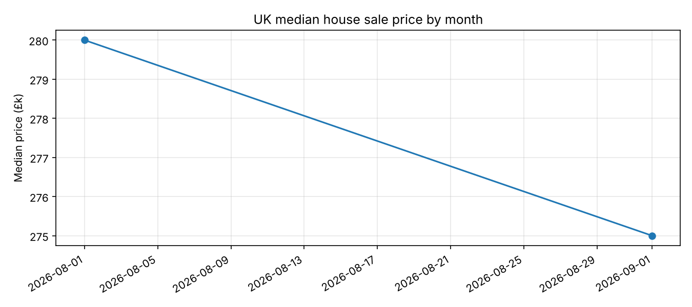

# UK House Price Pipeline

An end-to-end data pipeline on public [HM Land Registry Price Paid Data](https://www.gov.uk/government/statistical-data-sets/price-paid-data-downloads). It ingests, models, tests and publishes UK house sale prices, and refreshes itself every week with GitHub Actions.



*The chart above is regenerated by the weekly refresh workflow.*

## Architecture

```
Land Registry CSV ──► ingest.py ──► DuckDB (raw) ──► dbt (staging ► marts) ──► report.py ──► summary.csv + chart
                                                         │
                                                  dbt tests + pytest
```

| Layer | Tool | Purpose |
| --- | --- | --- |
| Ingest | Python, DuckDB | Download the yearly CSV and load `raw.price_paid` |
| Transform | dbt-duckdb | Staging view, then monthly UK and county marts |
| Quality | dbt tests, pytest | Uniqueness, nulls, accepted values, freshness, sanity checks |
| Orchestrate | GitHub Actions | Weekly refresh; CI on every pull request |
| Report | matplotlib | Writes `data/summary.csv` and `docs/chart.png` |

## Run it locally

```bash
python -m venv .venv && source .venv/bin/activate
pip install -r requirements.txt

python src/ingest.py                              # or: --year 2025
dbt build --project-dir dbt --profiles-dir dbt    # models + tests
python -m pytest -q                              # data quality checks
python src/report.py                              # writes chart + summary
```

To try it without downloading anything, load the small fixture instead:
`python src/ingest.py --file tests/fixtures/sample.csv`

## Project layout

```
src/            ingest.py, report.py
dbt/models/     staging/ and marts/ plus schema.yml (tests)
tests/          pytest data quality checks and a sample fixture
.github/        ci.yml (PRs) and refresh.yml (weekly schedule)
```

## Roadmap

- [ ] Swap the storage layer to Apache Iceberg
- [ ] Add a Dagster version of the orchestration alongside GitHub Actions
- [ ] Dockerise the pipeline
- [ ] Add a dbt incremental model for the full historical file
- [ ] Join in Bank of England base rate data

## Data licence

Contains HM Land Registry data © Crown copyright and database right. Licensed under the [Open Government Licence v3.0](https://www.nationalarchives.gov.uk/doc/open-government-licence/version/3/).
